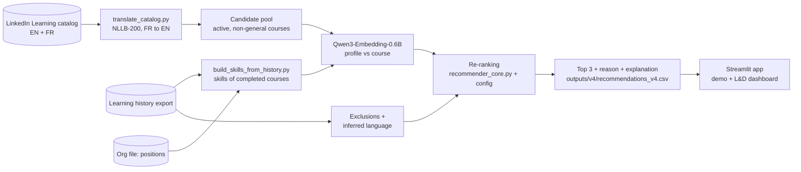

# Ooredoo Training Recommender: explainable course recommendations for every employee

<p>
  
  
  
  
</p>


**Which LinkedIn Learning course should each employee take next, and why?**

I built this during my SPE internship (2CS, ESI Algiers) in the HR department of
**Ooredoo Algérie**. It matches **1,059 employee positions** against the **10,765 active courses**
of the company's LinkedIn Learning catalog (8,729 English, 2,036 French). Each employee gets a
**top 3 with a plain-language reason** for every pick. Everything runs locally: after a one-time
model download, no employee data leaves the machine.

| | |
|---|---|
| Embedding model | `Qwen/Qwen3-Embedding-0.6B` (chosen from a 2 × 3 model/language grid) |
| Ranking | cosine similarity + 5 transparent re-ranking signals, all weights in one YAML file |
| Output per pick | `similarity`, `rank_score`, `reason` (numeric), `explanation` (sentence), `flagged_for_review` |
| Front end | Streamlit app: per-employee demo + 6-panel L&D dashboard |
| Tests | 14 pytest unit tests on synthetic data |

## Highlights

- **Every recommendation explains itself.** The numeric `reason` (`field match (+0.11), level match (+0.04)`)
  and the sentence shown to HR ("Recommended because it matches your field and it fits your
  seniority level") are built from the same list of boosts, so they cannot contradict each other.
  Picks with no field, stated-interest or format match behind them are marked `flagged_for_review`.
- **The model was measured, not assumed.** TF-IDF, `bge-m3` and `Qwen3-Embedding-0.6B` were run
  on translated-English and on native English+French text (6 runs over all 1,059 profiles).
  Translation made no measurable difference, so the pipeline runs in English only. Qwen3 covered
  the most of the catalog and was far less prone to "hub" courses.
- **An honest evaluation result.** In a temporal leave-one-out test, a plain *popularity* baseline
  beat every content model. The held-out completions turned out to be the courses the company
  pushes to everyone (64% are in the top 1% most popular). The test measures "did they take the
  promoted course", not relevance, so it was **not** used to tune the weights (details below).
- **Hubness, found and reduced.** In high-dimensional embedding spaces, a few items end up close to
  many unrelated queries ([Radovanović et al., 2010](https://www.jmlr.org/papers/v11/radovanovic10a.html)).
  Hand-checking ~660 picks showed this happening: "Careers in Commercial Banking" was a wrong #1 pick
  for people in several unrelated departments. V4 replaces a flat penalty with a continuous rebalance (below).

## How it works



1. **Profile text.** Department, direction, job title, role focus, skills from completed courses
   and the stated interest are concatenated and embedded as the *query*. Course title, subjects,
   skills and description are embedded as the *document*.
2. **Hard exclusions.** Retired courses, `general`-level courses (onboarding-style, the same for
   everyone), and anything the person completed or is taking. Dropped courses can come back.
3. **Re-ranking** on top of the raw cosine similarity:

```text
rank_score = similarity
           + 0.15 × field match          TF-IDF-weighted overlap of department words with course text
           + 0.15 × stated preference    only if the text contains a real catalog skill phrase
           + scale × ( 0.07 language     from completed history, if one language is > 60% of it
                                         (0.03 for English when there is no history)
                     + 0.05 level match  beginner / intermediate / advanced, soft
                     + 0.05 format )     Online / On-site Internal / On-site External
           − 0.10 × level mismatch

scale = 0.3 + 0.7 × clip(field match + preference, 0, 1)
```

The `scale` term is the V4 fix for hubness. Language, level and format say nothing about the
*topic*, so when a course has no topical link to the person, those three boosts shrink to 30% and
cannot carry an unrelated course to the top. The earlier version used a flat −0.08 penalty
triggered at exactly zero field match, and a tiny spurious match was enough to dodge it.

All weights and thresholds live in [`notebooks/test/recommender_config.yaml`](notebooks/test/recommender_config.yaml),
each with a comment explaining it.

## Results

### Model and language comparison (1,059 profiles, V3 scoring)

| Model | Courses reached (top 3) | Diversity within top 3 | "Careers in Commercial Banking" as #1 | C-suite strategy course as #1 | Embedding time |
|---|---:|---:|---:|---:|---:|
| TF-IDF | 532 (4.9%) | 0.73 | 2 | 2 | 4 s |
| `bge-m3` | 495 (4.6%) | **0.83** | 40 | 26 | 400 s |
| **`Qwen3-Embedding-0.6B`** | **589 (5.5%)** | 0.80 | 13 | **2** | 1,236 s |

The native (untranslated) runs were within 0.01 mean similarity and 3 hub picks of the translated
runs for every model. Raw similarity is not compared across models, because each model has its
own scale (mean top-1: 0.61 for `bge-m3`, 0.51 for Qwen3).

### Temporal leave-one-out (58 employees with a held-out completion)

Each person's most recent completed course is hidden. Their profile is rebuilt without it, and
the test checks whether it comes back in their top 3.

| Model | Precision@3 | Recall@3 | MRR |
|---|---:|---:|---:|
| Random | 0.0001 | 0.0003 | 0.001 |
| TF-IDF | 0.006 | 0.017 | 0.016 |
| `bge-m3` | 0.011 | 0.034 | 0.029 |
| `Qwen3-Embedding-0.6B` | 0.011 | 0.034 | **0.044** |
| Popularity | **0.126** | **0.379** | **0.220** |

Why popularity wins: the 58 held-out courses come from only 36 distinct titles. 64% are in the
**top 1%** most-taken courses and 100% in the top 5% (a random course would be there 1% and 5% of
the time). This ground truth mostly records which courses were widely assigned, not individual
fit. A recommender meant to
*personalise* should not be tuned to reproduce it, so the weights stay reasoned values. The
ablation (drop one signal at a time) did confirm that the format signal is a no-op on today's
online-only catalog.

### V4 rebalance (same model, before and after)

| Course | #1 pick before | #1 pick after |
|---|---:|---:|
| Creating Your IT Strategy | 121 (11.4%) | 99 (9.3%) |
| Careers in Commercial Banking | 13 (1.2%) | 13 (1.2%) |
| Strategic Vision … for C-Suite Leaders | 2 (0.2%) | 4 (0.4%) |

Before the evaluation was built, three rounds of hand-checking (~660 top-1 picks, stratified,
checked against an overlap proxy independent of the ranking code) judged roughly **93–97% of top-1
picks reasonable** and 2–4% clearly wrong. That is a sample-based judgement, not a ground-truth metric.

## Repository layout

```
app.py                              Streamlit app: recommender demo + 6-panel L&D dashboard
build_skills_from_history.py        fills employee Skills from completed LinkedIn Learning courses
scripts/translate_catalog.py        French course fields -> English with NLLB-200 (local)
notebooks/
  Recommend_V4_wired.ipynb          the pipeline: embed, score, rank, explain, save the top 3
  Recommend_Model_Comparison.ipynb  2 x 3 grid: {translated, native} x {TF-IDF, bge-m3, Qwen3}
  Recommend_Evaluation.ipynb        temporal leave-one-out, baselines, ablation, beyond-accuracy
  test/recommender_core.py          pure scoring functions used by the pipeline notebook
  test/recommender_config.yaml      every weight and threshold, with comments
  test/test_recommender_core.py     14 unit tests on hand-built synthetic data
data/README.md                      expected input files and columns (data not included)
```

## Getting started

```bash
# 1. environment (Python 3.11; an NVIDIA GPU helps but is not required)
python -m venv .venv && . .venv/bin/activate           # Windows: .venv\Scripts\activate
pip install torch --index-url https://download.pytorch.org/whl/cu128   # GPU, or: pip install torch
pip install -r requirements.txt
pytest notebooks/test -q                                # 14 passed

# 2. data: put your files in data/ as described in data/README.md, then
python scripts/translate_catalog.py                     # only if the catalog has no _EN columns yet
python build_skills_from_history.py

# 3. recommendations: open notebooks/Recommend_V4_wired.ipynb and Run All
#    (first run downloads Qwen3-Embedding-0.6B, ~1.2 GB; about 5 minutes on a GPU)
#    -> outputs/v4/recommendations_v4.csv

# 4. app
streamlit run app.py --browser.gatherUsageStats false   # http://localhost:8501
```

If Hugging Face is blocked on your network, download the model elsewhere and point `model.name`
in the config to the local folder. The last cell of the pipeline compares against the model
comparison's output. If you have not run that notebook, it prints a "skipping" message, which is expected.
To reproduce the results tables, run `Recommend_Model_Comparison.ipynb` first (the 6 runs), then
`Recommend_Evaluation.ipynb`, which reads the comparison's outputs.

## Data and privacy

- **Not in this repository:** the org file, the learning-activity export, the catalog export and
  every generated output. They belong to Ooredoo and LinkedIn and are per-employee. The notebooks
  are committed with all outputs cleared, and `.gitignore` blocks `data/`, `outputs/` and every CSV.
- During development, names and emails were synthetic placeholders. Only the org structure and the
  learning history were real.
- Nothing is sent to an API. Embedding and translation run on local Hugging Face models.

## Limitations

- **Weights are reasoned, not tuned.** The only automatic ground truth (leave-one-out) is
  popularity-contaminated, so there is no trustworthy metric to tune against yet. A small pilot
  with real employees rating their picks would be the right next step.
- **Hubness is reduced, not solved.** "Creating Your IT Strategy" is still the #1 pick for 9.3% of
  positions. Similarity-level corrections such as CSLS or mutual proximity are the obvious next step.
- **Sparse profiles.** Only 305 people appear in the history export, so for most positions the
  profile is department + role only, and recommendations are closer to "good for this role" than
  "good for this person".
- **The comparison and evaluation notebooks use V3's scoring.** V4 changed the rebalance after
  those runs.
- **The catalog is online-only,** so the training-format signal does nothing until on-site courses
  are added as catalog rows with a `Training_Type`.
- The NLLB-200 translation model is licensed CC-BY-NC 4.0 (non-commercial).

## En bref (français)

Système de recommandation de formations développé pendant mon stage SPE au département RH
d'**Ooredoo Algérie**. Pour chaque employé, il propose les **3 cours LinkedIn Learning** les plus
pertinents parmi 10 765 cours actifs, chacun avec une **explication en clair**. Le modèle
d'embeddings `Qwen3-Embedding-0.6B` est combiné à des règles transparentes : métier, intérêt
déclaré, langue, niveau et format. Tous les poids sont dans un fichier YAML commenté. Les données de
l'entreprise ne sont pas incluses dans ce dépôt, et tout s'exécute en local.

## Acknowledgements

Built during an SPE internship at Ooredoo Algérie (HR department), as part of the 2CS program at
ESI Algiers. This repository contains code only. It is not an official Ooredoo product, and no
company data is included. Development was AI-assisted (Claude Code). Every number above comes from
running the notebooks in this repository on the internship data.

MIT licence.
